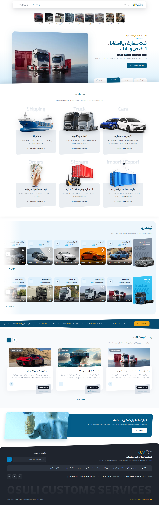

# Osuli Customs Services (خدمات گمرکی و بازرگانی اصولی)

> **High-Precision Figma-to-Code Frontend Implementation**  
> Built with **Next.js 16 (App Router)**, **React 19**, **TypeScript**, and **Tailwind CSS v4**.

[](https://nextjs.org/)
[](https://react.dev/)
[](https://www.typescriptlang.org/)
[](https://tailwindcss.com/)
[](#)

---

## 🌟 Project Overview & Purpose

This repository contains the production-grade frontend web implementation of the official landing page for **Osuli Customs Services (شرکت بازرگانی اصولی شجاعی)**, an Iranian international trade, commercial vehicle importation, and customs clearance enterprise.

Crafted as a pixel-accurate **Figma-to-Code portfolio and examination showcase**, this application translates complex geometric branding assets into clean, performant, and responsive web code. It adheres to strict Right-to-Left (RTL) Persian typographic standards, native CSS custom properties, and mathematical vector masks without compromising accessibility or mobile responsiveness.

---

## 🎨 Design Reference (Figma Specification)

Reviewers, examiners, and recruiters can inspect the rendered interface directly against the original Figma design specification:


*Figure 1: Full-page 1440px desktop reference render showcasing the exact geometry, typography, color harmony, and section balance as defined in the official Figma design system.*

---

## 🏛️ Key Architectural & Visual Highlights

### 1. Centralized Design Token Architecture (`src/styles/tokens.css`)
All visual styling is governed by semantic CSS custom properties defined in [`src/styles/tokens.css`](src/styles/tokens.css) and mirrored into Tailwind v4:
- **Brand Palette:** Primary Teal (`#035B81`), Ocean Blue (`#026AA2`), Deep Ribbon Teal (`#084B70`), Consultation CTA (`#045D89`), and Sky Blue (`#0284C7`).
- **Accent & Status Colors:** Warm Gold (`#F0A818`), Amber (`#F5B027`), Emerald Success (`#15803D`), and Error Red (`#B91C1C`).
- **Dark Surface Tokens:** Footer Surface (`#1F242D`), Newsletter Card (`#282E38`), and Navigation Pill Bar (`#2C333E`).
- **Geometric Baseline:** Unified `-3.5deg` parallel skew angle with calibrated counter-rotations for upright typography.

### 2. Native Persian Typography (Peyda / پیدا)
- Full integration of the **Peyda (`PeydaFaNum`)** font family loaded locally via `next/font/local` across 9 distinct font weights (`100 Thin` through `900 Black`).
- Automatic Persian numeral rendering (`FaNum`), optical kerning, and calibrated line-heights preserving legibility across all Iranian trade and financial terminology.

### 3. Custom SVG Clip-Paths & Geometric Masks
Unlike conventional rectangular web layouts, this project utilizes mathematical vector masks:
- **Dynamic Hero Mask (`ResizeObserver`):** An adaptive `userSpaceOnUse` SVG mask that tracks live container dimensions. It preserves a distinct top slope with `20px` rounded top corners on desktop, and dynamically introduces symmetrical `20px` rounded bottom corners (`Q` / `A` curves) on mobile and tablet (`< 1024px`) viewports.
- **Asymmetric Service Cards (`ServicesGrid`):** Dual-layer clipping featuring upward-slanted polygon bases with overlapping 3D service graphics.
- **Parallelogram Banners (`CtaBanner`):** Precise `-3.5deg` parallel vertical edges with undistorted corner rounding.
- **Diagonal Footer Slant (`Footer`):** Custom SVG clip-path (`#footer-top-slant-mask`) creating an angular boundary over the dark surface.

### 4. Interactive & Responsive Components
- **Hero Slider:** Auto-playing carousel with category-switching tabs (`امور گمرکی`, `خودرو`, `کشنده`, `حمل بین‌الملل`), synchronized progress timers, and responsive re-ordering for mobile viewports.
- **Daily Prices Carousels (`VehicleCatalog`):** Dual horizontal scroll tracks for passenger cars and commercial heavy trucks, featuring pinned category banners and auto-reset idle timers.
- **Infinite Currency Ticker:** Full-bleed marquee with pause-on-hover interaction displaying live foreign exchange rates (EUR, USD, AED, etc.).
- **Articles & Insights (`WeblogSection`):** 3-column editorial grid with protruding parallelogram author/date badges and directional vector navigation links.
- **Mobile Navigation Drawer:** Responsive slide-over drawer housing navigation links, contact actions, and authentication controls below `1024px`.

---

## 🛠️ Tech Stack & Directory Structure

- **Framework:** Next.js 16.4.6 (App Router, Turbopack)
- **Library:** React 19.3.0
- **Language:** TypeScript 5.x
- **Styling:** Tailwind CSS 4.3.3 & CSS Custom Properties
- **Icons & Graphics:** Custom inline SVG vectors & Lucide React

```
azar_tarkhis/
├── public/
│   ├── docs/
│   │   └── figma-reference.png     # Full-page 1440px design reference
│   ├── icons/                      # Branded SVG vectors, logos & chevrons
│   └── images/                     # Optimized WebP/PNG vehicles & service assets
├── src/
│   ├── app/
│   │   ├── globals.css             # Tailwind v4 import & global animations
│   │   ├── layout.tsx              # Root HTML, RTL layout & Peyda font definition
│   │   └── page.tsx                # Composition of all landing page sections
│   ├── components/
│   │   ├── layout/
│   │   │   └── Footer.tsx          # Full-bleed dark footer & watermark re-export
│   │   ├── sections/
│   │   │   ├── Header.tsx          # Floating navbar & mobile drawer
│   │   │   ├── StoriesBar.tsx      # Instagram-style circular service bubbles
│   │   │   ├── HeroSlider.tsx      # Dynamic-masked hero carousel & tabs
│   │   │   ├── ServicesGrid.tsx    # 3x2 service matrix with vector chevrons
│   │   │   ├── VehicleCatalog.tsx  # Horizontal vehicle price showcase
│   │   │   ├── CurrencyTicker.tsx  # Infinite marquee ribbon
│   │   │   ├── WeblogSection.tsx   # Articles & news cards
│   │   │   ├── CtaBanner.tsx       # Skewed consultation banner & modal
│   │   │   └── Footer.tsx          # Detailed footer with giant vector watermark
│   │   └── ui/
│   │       └── Container.tsx       # 1380px max-width wrapper
│   ├── data/
│   │   └── homeData.ts             # Typed mock datasets matching Figma specs
│   ├── fonts/                      # Peyda Persian font files (100–900 weights)
│   ├── lib/
│   │   └── utils.ts                # Class merging utility (clsx + tailwind-merge)
│   └── styles/
│       └── tokens.css              # Centralized Figma design tokens
├── FIGMA_SPECS.md                  # Comprehensive architectural spec sheet
├── package.json
├── tsconfig.json
└── README.md
```

---

## 🚀 Getting Started

### Prerequisites
- [Node.js](https://nodejs.org/) (v18.18.0 or newer recommended)
- `npm` or `pnpm`

### 1. Clone & Install
```bash
# Clone the repository
git clone https://github.com/sksbkt/azar-tarkhis.git

# Navigate into the workspace
cd azar-tarkhis

# Install dependencies
npm install
```

### 2. Development Mode
Run the development server with hot-module replacement and live Turbopack compiling:
```bash
npm run dev
```
Open [http://localhost:3000](http://localhost:3000) in your browser.

### 3. Production Build & Verification
Create an optimized production bundle and verify TypeScript types:
```bash
npm run build
npm run start
```

---

## 📄 License & Credits
Developed as an advanced design-system and frontend implementation showcase based on the **Osuli Customs Services (بازرگانی اصولی شجاعی)** specification. All graphic assets and logos belong to their respective copyright holders.
